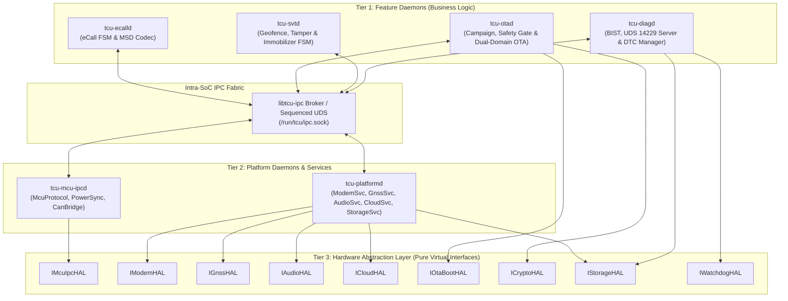

# High-Level Design Document (HLD)
## Project: Automotive Telematics Control Unit (TCU) on Yocto Linux

---

## 1. Subsystem & Daemon Responsibilities

The Yocto Linux user-space software is decomposed into **6 isolated long-running daemons**, **1 shared IPC library (`libtcu-ipc`)**, **1 diagnostic CLI (`tcu-ctl`)**, and **1 Virtual MCU Simulator (`tcu-mcu-sim` for Host/QEMU testing)**:

| Executable / Module | Architectural Tier | Linux User | Core Responsibilities | Primary Dependencies |
|---|---|---|---|---|
| **`tcu-mcu-ipcd`** | Tier 2 (Platform) | `tcu-mcu` | Exclusive owner of SPI/UART link to Companion MCU; CRC-16 framing; routes CAN signals, wakeup reasons, UDS frames, and MCU DFU blocks; manages Linux suspend handshake & MCU watchdog heartbeat | `IMcuIpcHAL`, `libtcu-ipc` |
| **`tcu-platformd`** | Tier 2 (Platform) | `tcu-plat` | Manages Cellular Modem (data + emergency voice), multi-constellation GNSS trail cache, Audio Codec routing, mTLS MQTT/HTTPS Cloud transport, and persistent SQLite store-and-forward | `IModemHAL`, `IGnssHAL`, `IAudioHAL`, `ICloudHAL`, `IStorageHAL` |
| **`tcu-ecalld`** | Tier 1 (Feature) | `tcu-ecall` | Highest-priority safety daemon (`SCHED_FIFO`); monitors crash/SOS events, preempts modem/audio, encodes CEN EN 15722 140-byte MSD, dials PSAP `112`, manages voice & 60-min callback window | `libtcu-ipc` $\to$ `tcu-mcu-ipcd`, `tcu-platformd` |
| **`tcu-otad`** | Tier 1 (Feature) | `tcu-ota` | Orchestrates UN R156 campaigns: resumable HTTPS download, X.509/Ed25519 signature check, vehicle safety gate check, RAUC A/B Linux RootFS slot update, MCU Dual-Bank DFU, post-boot commit/rollback | `IOtaBootHAL`, `ICryptoHAL`, `libtcu-ipc` |
| **`tcu-svtd`** | Tier 1 (Feature) | `tcu-svt` | Anti-theft state machine: auto-arms on park/lock, monitors Haversine geofence, IMU tilt/tow & 12V battery cut (BUB failover), runs silent 5s GPS+CellID tracking, enforces zero-speed immobilizer inhibit | `libtcu-ipc` $\to$ `tcu-mcu-ipcd`, `tcu-platformd` |
| **`tcu-diagd`** | Tier 1 (Feature) | `tcu-diag` | Executes startup & 30s periodic BIST, controls cabin eCall status LED, manages persistent DTCs, processes ISO 14229 UDS (`0x10`, `0x22`, `0x19`, `0x31`), exposes test/fault-injection socket | `IWatchdogHAL`, `IStorageHAL`, `libtcu-ipc` |
| **`tcu-ctl`** | Tooling | `root` / `tcu-diag` | Developer/QA/EOL command-line utility for inspecting live telemetry, running BIST, triggering test eCalls, and injecting synthetic crash/tamper/OTA events | Connects to `tcu-diagd` UDS |
| **`tcu-mcu-sim`** | Emulation | `tcu-mcu` | Host PC & `qemuarm64` simulator modeling NXP S32K144 Power FSM, virtual CAN (`vcan0`), IMU, BUB voltage, and Dual-Bank MCU DFU bootloader over virtual PTY/Socket | Host/QEMU Only |

---

## 2. High-Level Subsystem Interaction Diagram

---

## 3. Intra-SoC IPC Contracts (`libtcu-ipc`)

All Linux daemons communicate using typed binary/CBOR-like structs over `AF_UNIX` (`SOCK_SEQPACKET`), preserving exact message boundaries without stream fragmentation. Two patterns are supported:

### 3.1 Asynchronous Pub/Sub Topics (Event-Driven)

| Topic ID | Topic Name | Publisher | Subscribers | Rate / Trigger | Payload Summary |
|---|---|---|---|---|---|
| `0x0101` | `TOPIC_VEHICLE_STATE` | `tcu-mcu-ipcd` | `otad`, `svtd`, `ecalld`, `diagd` | 10 Hz / On-change | `speed_kmh`, `ignition_kl15`, `gear`, `doors_locked`, `kl30_mv`, `bub_mv`, `bub_soc` |
| `0x0102` | `TOPIC_EMERGENCY_TRIGGER`| `tcu-mcu-ipcd`, `diagd` | `tcu-ecalld`, `otad`, `platformd` | Immediate (`< 5 ms`)| `trigger_source` (`AIRBAG`, `SOS_BTN`, `TEST_CALL`), `delta_v_kmh`, `rollover` |
| `0x0103` | `TOPIC_SECURITY_TAMPER` | `tcu-mcu-ipcd`, `platformd`| `tcu-svtd`, `diagd` | Immediate | `tamper_type` (`KL30_CUT`, `IMU_TOW_TILT`, `GNSS_JAM`, `UNAUTHORIZED_MOVE`) |
| `0x0104` | `TOPIC_POWER_TRANSITION`| `tcu-mcu-ipcd` | All Daemons | On state change | `target_state` (`ACTIVE`, `POST_RUN`, `PREPARE_SLEEP`), `wakeup_reason` |
| `0x0201` | `TOPIC_GNSS_FIX` | `tcu-platformd` | `svtd`, `ecalld`, `diagd` | 1 Hz (10 Hz emergency)| `lat_deg`, `lon_deg`, `alt_m`, `heading_deg`, `speed_mps`, `hdop`, `fix_valid` |
| `0x0202` | `TOPIC_CLOUD_COMMAND` | `tcu-platformd` | `otad`, `svtd`, `diagd` | On MQTT RX | Verified command (`OTA_NOTIFY`, `SVT_ARM`, `SVT_ACTIVATE`, `SVT_IMMOBILIZE`, `REMOTE_DIAG`) |
| `0x0301` | `TOPIC_BIST_HEALTH` | `tcu-diagd` | `otad`, `platformd`, `mcu-ipcd` | Startup + every 30s | Subsystem pass/fail bitmask, active DTC count, eCall readiness LED state |

### 3.2 Request-Response RPCs (Deterministic Timeout)

| RPC Method | Caller | Provider | Timeout | Purpose |
|---|---|---|---|---|
| `AcquireEmergencyChannel()` | `tcu-ecalld` | `tcu-platformd` | `100 ms` | Preempts data/OTA, locks cellular voice & cabin audio codec for eCall |
| `DialEmergencyAndSendMsd()` | `tcu-ecalld` | `tcu-platformd` | `5000 ms` | Initiates `112` / test PSAP call and transmits 140-byte MSD |
| `GetGnssTrail()` | `tcu-ecalld` | `tcu-platformd` | `50 ms` | Retrieves current GNSS fix + `N-1`, `N-2` historical positions for MSD |
| `RequestPowerLock(reason)` | `ecalld`, `otad`, `svtd` | `tcu-mcu-ipcd` | `100 ms` | Prevents TCU transition to `SLEEP` during active eCall, OTA flash, or SVT alarm |
| `FlashMcuFirmwareBank()` | `tcu-otad` | `tcu-mcu-ipcd` | `60000 ms`| Streams verified MCU image chunks over SPI to MCU inactive bank |
| `SetImmobilizerState()` | `tcu-svtd` | `tcu-mcu-ipcd` | `250 ms` | Requests starter inhibit on BCM (re-verified at MCU level for `Speed == 0`) |
| `ExecuteAudioLoopback()` | `tcu-diagd` | `tcu-platformd` | `1000 ms` | Runs 1 kHz silent/sub-audible codec loopback test for eCall readiness |

---

## 4. Resource Arbitration & Preemption Rules

Because multiple telematics features share the Cellular Modem, Power State, and MCU SPI bus, strict priority arbitration is enforced across the TCU:

| Priority Rank | Subsystem / Activity | Preemption Rights | Sleep Inhibit Policy |
|---|---|---|---|
| **P0 (Highest — Safety)** | **`tcu-ecalld` (Active Live eCall)** | Immediately aborts/pauses OTA downloads, MCU DFU (if not in atomic swap commit), SVT cloud sync, and UDS routines; owns Modem + Audio exclusively | Unconditional Wake Lock (runs until PSAP release + callback window or BUB depletion) |
| **P1 (Security Critical)** | **`tcu-svtd` (`STOLEN_ACTIVE`)** | Overrides `SLEEP` into covert periodic wake; pauses non-critical OTA campaigns; yields cellular voice only to P0 eCall | Timed Wake Lock (continuous when moving; duty-cycled on BUB when stationary) |
| **P2 (Diagnostics / EOL)** | **`tcu-diagd` (Active UDS / Test eCall)**| Can run BIST and Test eCall when P0/P1 are idle | Wake Lock while diagnostic tester (`0x3E` TesterPresent) is active |
| **P3 (Maintenance)** | **`tcu-otad` (OTA Install / Flash)** | Permitted **only** when P0/P1 are idle and Vehicle Safety Gate (`Speed == 0`, `PARK`, `IGN == OFF`, `KL30 >= 12.2V`) holds | Bounded Maintenance Wake Lock (`max 15 min`) during POST_RUN |
| **P4 (Lowest — Normal)** | **Routine Telemetry & Log Upload** | Best-effort background MQTT QoS 1; queued to SQLite when preempted or offline | Never blocks `SLEEP` transition |
