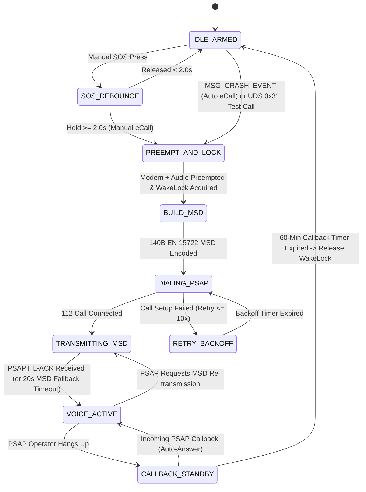
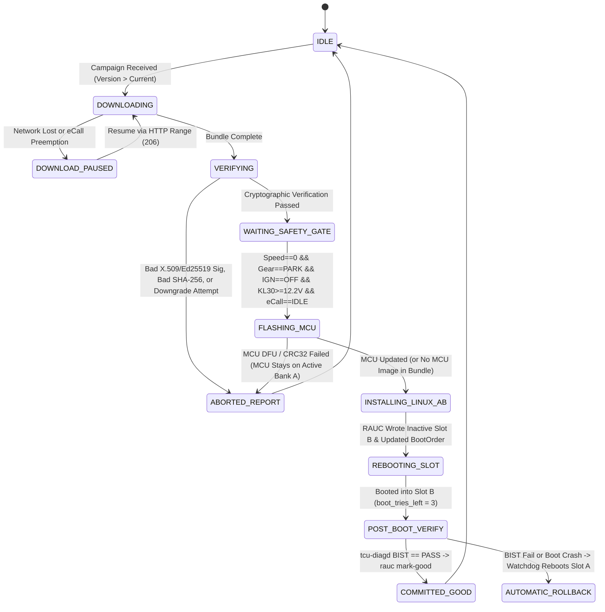

# Low-Level Design Document (LLD)
## Project: Automotive Telematics Control Unit (TCU) on Yocto Linux

---

## 1. Inter-Processor Binary Protocol (SA515M $\leftrightarrow$ Companion MCU)

Because SA515M (Linux) and the Companion MCU (RTOS) do not share memory or ABI endianness guarantees, all SPI/UART transactions use a deterministic little-endian framed protocol with **CRC-16-CCITT (`0x1021`, init `0xFFFF`)**.

### 1.1 Wire Frame Layout
```text
Byte Offset:  0      1      2       3      4..5     6..7       8..(8+N-1)    8+N..9+N
            +------+------+-------+-------+--------+---------+--------------+----------+
            | 0x55 | 0xAA | MsgID | Flags | SeqNum | PayLen  |   Payload    |  CRC-16  |
            +------+------+-------+-------+--------+---------+--------------+----------+
            |<-- SOF ---->|  1B   |  1B   | uint16 | uint16  | 0..1024 Byte |  uint16  |
```
* **`Flags` Bitfield**: `bit0 = ACK_REQ`, `bit1 = IS_ACK`, `bit2 = IS_NACK`, `bit3 = URGENT_WAKE`.
* **Reliability**: Frames with `ACK_REQ = 1` wait up to `50 ms` for `[IS_ACK, matching SeqNum]`, retrying up to `3` times before raising DTC `U0100 (Lost Communication With Companion MCU)`.

### 1.2 Core MCU $\leftrightarrow$ SA515M Message ID Table

| MsgID | Direction | Mnemonic | Payload Structure | Trigger / Rate |
|---|---|---|---|---|
| `0x01` | Both | `MSG_HEARTBEAT_WDG` | `uint8_t linux_state; uint8_t active_locks; uint32_t uptime_ms` | Every `2000 ms` |
| `0x02` | MCU $\to$ SoC | `MSG_WAKEUP_REASON` | `uint8_t reason; uint16_t kl30_mv; uint16_t bub_mv` | On Boot / Resume |
| `0x03` | Both | `MSG_POWER_TRANSITION` | `uint8_t target_power_state; uint16_t grace_timeout_ms` | State Change |
| `0x10` | MCU $\to$ SoC | `MSG_VEHICLE_TELEMETRY`| `uint16_t speed_cms; uint8_t ign; uint8_t gear; uint8_t doors; uint16_t kl30_mv; uint8_t bub_soc` | `10 Hz` (Run) |
| `0x11` | MCU $\to$ SoC | `MSG_CRASH_EVENT` | `uint8_t airbag_mask; int16_t dv_x; int16_t dv_y; uint8_t rollover` | Urgent IRQ (`< 2 ms`)|
| `0x12` | MCU $\to$ SoC | `MSG_TAMPER_EVENT` | `uint8_t tamper_flags; int16_t tilt_pitch_cdeg; int16_t tilt_roll_cdeg` | Urgent IRQ |
| `0x20` | SoC $\to$ MCU | `MSG_SET_ECALL_LED` | `uint8_t led_mode` (`0=OFF, 1=GREEN_READY, 2=BLINK_CALL, 3=RED_FAULT`) | On State Change |
| `0x21` | SoC $\to$ MCU | `MSG_SET_IMMOBILIZER` | `uint8_t inhibit_enable; uint32_t auth_token_crc` | SVT Command |
| `0x30` | Both | `MSG_UDS_ISOTP_PDU` | `uint16_t can_id; uint8_t uds_bytes[1..512]` | On OBD/CAN UDS |
| `0x40` | SoC $\to$ MCU | `MSG_MCU_OTA_BEGIN` | `uint32_t fw_size; uint32_t expected_crc32; uint32_t fw_version` | MCU DFU Start |
| `0x41` | SoC $\to$ MCU | `MSG_MCU_OTA_CHUNK` | `uint32_t offset; uint16_t chunk_len; uint8_t data[512]` | MCU DFU Stream |
| `0x42` | SoC $\to$ MCU | `MSG_MCU_OTA_COMMIT` | `uint8_t swap_bank_and_reset` | MCU DFU Finish |

### 1.3 CRC-16-CCITT Implementation
```cpp
uint16_t computeCrc16Ccitt(const uint8_t* data, size_t length) noexcept {
    uint16_t crc = 0xFFFF;
    for (size_t i = 0; i < length; ++i) {
        crc ^= static_cast<uint16_t>(data[i]) << 8;
        for (int bit = 0; bit < 8; ++bit) {
            crc = (crc & 0x8000) ? ((crc << 1) ^ 0x1021) : (crc << 1);
        }
    }
    return crc;
}
```

---

## 2. Feature 1: Emergency Call (`tcu-ecalld`) & CEN EN 15722 MSD

### 2.1 `tcu-ecalld` Finite State Machine


### 2.2 Minimum Set of Data (MSD — 140 Bytes, CEN EN 15722)
Coordinates are encoded in **milliarcseconds (mas)** per WGS84:
$$\text{lat\_mas} = \text{round}(\text{latitude\_deg} \times 3{,}600{,}000), \quad \text{lon\_mas} = \text{round}(\text{longitude\_deg} \times 3{,}600{,}000)$$
Historical breadcrumb deltas (`N-1` and `N-2`) are encoded in `0.1 arcsecond` (`100 mas`) signed offsets `[-512, +511]` relative to the primary crash location:

```cpp
struct EcallMsdPayload {
    uint8_t  format_version{2};          // CEN EN 15722 v2/v3
    uint8_t  message_identifier{1};      // Increments on each MSD retransmission in same call
    bool     automatic_activation{true}; // true = Airbag/IMU crash, false = Manual SOS
    bool     test_call{false};           // true = UDS 0x31 / Test Service non-112 call
    bool     position_can_be_trusted{true};
    uint8_t  vehicle_type{1};            // 1 = Passenger vehicle class M1
    char     vin[17];                    // ISO 3779 17-char Vehicle Identification Number
    uint8_t  propulsion_mask{0x04};      // Bitmask: Gasoline/Diesel/BEV/Hybrid
    uint32_t timestamp_utc{0};           // Seconds since Unix epoch
    int32_t  latitude_mas{0};            // [-324000000 .. +324000000]
    int32_t  longitude_mas{0};           // [-648000000 .. +648000000]
    uint8_t  vehicle_direction{0xFF};    // 0..179 (2-degree increments), 0xFF = unknown
    int16_t  recent_n1_lat_delta{0};     // 100 mas units
    int16_t  recent_n1_lon_delta{0};
    int16_t  recent_n2_lat_delta{0};
    int16_t  recent_n2_lon_delta{0};
    uint8_t  number_of_passengers{1};
    int16_t  crash_delta_v_kmh{0};       // Optional Additional Data (OAD)
}; // Packed/serialized into fixed 140-byte ASN.1 UPER frame + padding
```

---

## 3. Feature 2: Full Automotive OTA (`tcu-otad`)

### 3.1 OTA State Machine & Atomic Rollback Guarantee


### 3.2 OTA Bundle Manifest (`manifest.json` inside Signed Archive)
```json
{
  "campaign_id": "OTA-2026-TCU-042",
  "hw_compatibility": ["sa515m-s32k144-revB", "qemuarm64-tcu"],
  "bundle_version": "2.4.0",
  "min_anti_rollback_version": "2.1.0",
  "artifacts": {
    "linux_rauc_bundle": {
      "filename": "tcu-rootfs-2.4.0.raucb",
      "size_bytes": 184549376,
      "sha256": "9f86d081884c7d659a2feaa0c55ad015a3bf4f1b2b0b822cd15d6c15b0f00a08"
    },
    "mcu_firmware": {
      "present": true,
      "filename": "s32k144-app-1.8.2.bin",
      "version": "1.8.2",
      "size_bytes": 196608,
      "crc32": "0xE49B210A",
      "sha256": "4b227777d4dd1fc61c6f884f48641d02b4d121d3fd328cb08b5531fcacdabf8a"
    }
  }
}
```

---

## 4. Feature 3: Stolen Vehicle Tracking (`tcu-svtd`)

### 4.1 Haversine Geofence Breach Formula
When the vehicle parks (`Ignition == OFF && Doors == LOCKED`), `tcu-svtd` stores anchor coordinates $(\phi_0, \lambda_0)$. For each new fix $(\phi, \lambda)$ while `AuthorizedDriver == false`, spherical distance $d$ (meters) with $R = 6{,}371{,}000\text{ m}$ is computed:
$$a = \sin^2\left(\frac{\Delta \phi}{2}\right) + \cos(\phi_0)\cos(\phi)\sin^2\left(\frac{\Delta \lambda}{2}\right), \quad d = 2 R \cdot \text{atan2}\left(\sqrt{a}, \sqrt{1 - a}\right)$$
If $d > R_{\text{geofence}}$ (default $100\text{ m}$) and `HDOP <= 2.5`, `SVT_GEOFENCE_BREACH` is raised immediately.

### 4.2 Zero-Speed Immobilizer Safety Interlock (Defense-in-Depth)
To prevent hazardous engine shutdown on a moving vehicle, **two independent checks** must pass before starter inhibit is asserted:
1. **Linux Tier (`tcu-svtd`)**: Verifies cloud command signature + monotonic `anti_replay_nonce`, holds state in `IMMOBILIZE_PENDING` until `speed_kmh == 0.0` AND `ignition_kl15 == false` continuously for `>= 3000 ms`, then sends `MSG_SET_IMMOBILIZER(ENABLE)`.
2. **MCU Tier (Hardware Gate)**: Companion MCU re-verifies live CAN wheel-speed pulses `== 0` and `KL15 == OFF` before transmitting the authenticated immobilizer CAN frame to the Body Control Module (BCM).

---

## 5. Feature 4: Test Service & UDS Diagnostics (`tcu-diagd` & `tcu-ctl`)

### 5.1 Supported ISO 14229 UDS Services & DIDs

| UDS Service | Sub-Function / DID | Description | Access Session |
|---|---|---|---|
| `0x10` | `0x01 / 0x03 / 0x60` | Diagnostic Session Control: Default, Extended, EOL Safety Test | All |
| `0x3E` | `0x00` | TesterPresent (maintains Diagnostic WakeLock) | Extended / EOL |
| `0x22` | `0xF190` | Read VIN (17 ASCII bytes) | All |
| `0x22` | `0xF189` | Read TCU Linux + MCU Firmware Versions | All |
| `0x22` | `0xFD01` | Read Live GNSS Fix (`lat`, `lon`, `sats`, `hdop`, `antenna_state`) | All |
| `0x22` | `0xFD02` | Read Cellular Modem Status (`RAT`, `RSSI`, `MCC/MNC`, `IMEI`) | All |
| `0x22` | `0xFD03` | Read Power & Backup Battery (`KL30 mV`, `BUB mV`, `BUB SoC%`, `BUB SoH%`) | All |
| `0x22` | `0xFD04` | Read Dual-Bank OTA Status (`active_slot`, `last_campaign`, `rollback_cnt`) | All |
| `0x22` | `0xFD05` | Read SVT Security State (`ARMED/STOLEN`, `immobilizer_state`) | Extended / EOL |
| `0x19` / `0x14`| `0x02` / `0xFFFFFF` | Read DTC by Status Mask / Clear All Diagnostic Trouble Codes | All / Extended |
| `0x31` | `0x01 0x0201` | **RoutineControl: Start Test eCall** (dials test PSAP with `test_call=true`) | Extended / EOL |
| `0x31` | `0x01 0x0202` | **RoutineControl: Run Codec Audio Loopback BIST** | Extended / EOL |
| `0x31` | `0x01 0x0203` | **RoutineControl: Trigger Full Subsystem BIST** | All |

### 5.2 Standard TCU Diagnostic Trouble Codes (DTCs)
* `B1A01-13`: GNSS Active Antenna Circuit Open (`antenna_current < 2 mA`).
* `B1A01-11`: GNSS Active Antenna Circuit Short to Ground (`antenna_current > 45 mA`).
* `B1A02-01`: eCall Backup Battery (BUB) State-of-Health Degraded (`SoH < 70%` or internal resistance high).
* `B1A03-01`: eCall Cabin Microphone / Speaker Loopback Failure.
* `U0100-87`: Lost SPI/UART Communication With Companion MCU (`> 3` consecutive CRC/ACK timeouts).
* `U0140-87`: Lost CAN Communication With Body Control Module / Gateway.

---

## 6. Persistent SQLite3 Storage Schema (`/data/db/tcu_persistence.db`)

Configured in `PRAGMA journal_mode=WAL; PRAGMA synchronous=NORMAL;` for crash resilience across sudden battery loss:

```sql
-- 1. Offline Store-and-Forward Breadcrumbs (SVT & General Telemetry)
CREATE TABLE IF NOT EXISTS telemetry_queue (
    id INTEGER PRIMARY KEY AUTOINCREMENT,
    priority INTEGER NOT NULL,          -- 0=eCalllog, 1=SVT_Alarm, 2=Normal
    created_utc INTEGER NOT NULL,
    topic TEXT NOT NULL,
    encrypted_payload BLOB NOT NULL,    -- AES-256-GCM / JSON payload
    retry_count INTEGER DEFAULT 0
);
CREATE INDEX IF NOT EXISTS idx_telem_prio_time ON telemetry_queue(priority ASC, id ASC);

-- 2. Persistent Diagnostic Trouble Codes (ISO 14229 Status Byte)
CREATE TABLE IF NOT EXISTS dtc_records (
    dtc_code TEXT PRIMARY KEY,          -- e.g. 'B1A02-01'
    status_mask INTEGER NOT NULL,       -- Bit0=testFailed, Bit3=confirmedDTC
    first_seen_utc INTEGER NOT NULL,
    last_seen_utc INTEGER NOT NULL,
    occurrence_count INTEGER NOT NULL DEFAULT 1,
    freeze_frame_json TEXT              -- KL30 mV, Speed, Temp at fault time
);

-- 3. UN R156 OTA Campaign & Audit Trail Journal
CREATE TABLE IF NOT EXISTS ota_journal (
    campaign_id TEXT PRIMARY KEY,
    target_version TEXT NOT NULL,
    previous_slot TEXT NOT NULL,
    target_slot TEXT NOT NULL,
    state TEXT NOT NULL,                -- DOWNLOADING, VERIFIED, FLASHED_MCU, REBOOTING, COMMITTED, ROLLED_BACK
    bytes_downloaded INTEGER DEFAULT 0,
    updated_utc INTEGER NOT NULL,
    failure_reason TEXT
);
```
### Ring-Buffer Eviction Policy:
When `telemetry_queue` exceeds `50,000` rows during prolonged underground parking without cellular signal, priority `2` (normal telemetry) rows are evicted oldest-first while preserving priority `1` (`STOLEN_ACTIVE` breadcrumbs).
