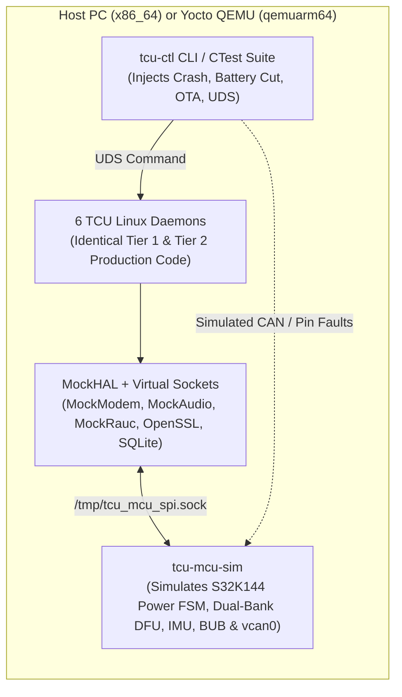

# Software Design Document (SWDD)
## Project: Automotive Telematics Control Unit (TCU) on Yocto Linux

---

## 1. Repository & Package Decomposition

The C++17 codebase preserves the proven **3-Layer Modular Architecture** (`daemons` [App] $\to$ `service` $\to$ `hal`) while scaling cleanly to **Multi-Process Linux Daemons** connected via `libtcu-ipc`:

```text
include/ & src/
├── common/                         # Shared Foundation Library (libtcu-common)
│   ├── types.h                     # Domain structs (GnssFix, VehicleState, OtaManifest, DtcRecord)
│   ├── crc16.h / .cpp              # CRC-16-CCITT & CRC-32 calculators
│   ├── msd_codec.h / .cpp          # CEN EN 15722 140-byte eCall MSD encoder/decoder
│   ├── geo_math.h / .cpp           # Haversine distance & Ray-Casting polygon geofence math
│   ├── config_loader.h / .cpp      # YAML configuration parser & validator
│   └── logger.h / .cpp             # spdlog + systemd-journald structured logging wrapper
│
├── ipc/                            # Intra-SoC IPC Library (libtcu-ipc)
│   ├── ipc_protocol.h              # Envelope header, Topic IDs, RPC Method IDs, Error codes
│   ├── uds_broker.h / .cpp         # epoll-based AF_UNIX SOCK_SEQPACKET router (embedded in mcu-ipcd/broker)
│   └── ipc_client.h / .cpp         # Async Pub/Sub + Timed RPC client used by every daemon
│
├── hal/                            # Tier 3: Hardware Abstraction Layer (libtcu-hal)
│   ├── i_mcu_ipc_hal.h             # SPI / UART byte/frame transport + IRQ pin wait
│   ├── i_modem_hal.h               # Cellular registration, VoLTE/CS 112 call, Cell-ID info
│   ├── i_gnss_hal.h                # Multi-constellation fix stream & antenna fault status
│   ├── i_audio_hal.h               # PCM voice routing, mute/unmute, 1 kHz diagnostic loopback
│   ├── i_ota_boot_hal.h            # RAUC A/B slot status, bundle install, mark-good, rollback
│   ├── i_crypto_hal.h              # X.509 / Ed25519 signature verification, SHA-256, HSM key access
│   ├── i_cloud_hal.h               # mTLS MQTT client & resumable HTTPS Range downloader
│   ├── i_storage_hal.h             # SQLite3 WAL transactional persistence
│   ├── i_watchdog_hal.h            # Linux /dev/watchdog & systemd sd_notify keepalive
│   ├── sa515m/                     # Production SA515M Linux concrete implementations
│   └── mock/                       # Deterministic Host PC & QEMU Mock implementations
│
├── service/                        # Tier 2: Platform-Independent Domain Services (libtcu-service)
│   ├── mcu_protocol_service        # Binary framing [0xAA55], SeqNum, ACK/Retry, MCU DFU chunker
│   ├── power_manager_service       # Wake-lock registry & coordinated Linux suspend preparation
│   ├── modem_service               # Emergency call preemption & cellular health monitor
│   ├── gnss_service                # N, N-1, N-2 breadcrumb ring buffer & dead-reckoning hold
│   ├── cloud_telemetry_service     # Topic routing, JSON/CBOR serialization, offline queue sync
│   └── persistent_store_service    # Encrypted SVT breadcrumbs, DTC table, OTA state journal
│
├── daemons/                        # Tier 1: Multi-Process Executables (Business State Machines)
│   ├── mcu_ipcd/                   # tcu-mcu-ipcd: MCU SPI/UART gateway + IPC broker host
│   ├── platformd/                  # tcu-platformd: Modem, GNSS, Audio, Cloud & SQLite daemon
│   ├── ecalld/                     # tcu-ecalld: EN 15722 Emergency Call FSM
│   ├── otad/                       # tcu-otad: UN R156 Dual-Domain OTA Orchestrator FSM
│   ├── svtd/                       # tcu-svtd: Stolen Vehicle Tracking & Safe Immobilizer FSM
│   └── diagd/                      # tcu-diagd: BIST, UDS ISO 14229 Server & Fault Injection API
│
└── tools/
    ├── tcu_ctl/                    # tcu-ctl: CLI diagnostic, BIST & HIL/SIL fault injection tool
    └── mcu_sim/                    # tcu-mcu-sim: Virtual Companion MCU (Power, CAN, IMU, BUB, DFU)
```

---

## 2. Dependency Injection & Daemon Lifecycle Pattern

Global singletons are strictly forbidden. Every daemon instantiates its concrete HALs (selected via `--mock` flag or `hal_backend: "sa515m" | "mock"` in `tcu_config.yaml`), injects them into Services via constructor references, and registers `SIGTERM`/`SIGINT` handlers for deterministic shutdown:

```cpp
// Example: Dependency Injection inside tcu-otad (src/daemons/otad/main.cpp)
int main(int argc, char* argv[]) {
    auto cfg = tcu::common::ConfigLoader::load(parseConfigPath(argc, argv));
    bool use_mock = hasFlag(argc, argv, "--mock") || (cfg.system.hal_mode == "mock");

    // 1. Instantiate Tier 3 HALs
    std::unique_ptr<tcu::hal::IOtaBootHAL> ota_boot_hal;
    std::unique_ptr<tcu::hal::ICryptoHAL>  crypto_hal;
    std::unique_ptr<tcu::hal::IStorageHAL> storage_hal;

    if (use_mock) {
        ota_boot_hal = std::make_unique<tcu::hal::MockOtaBootHAL>("/tmp/tcu_mock_slots.json");
        crypto_hal   = std::make_unique<tcu::hal::OpenSslCryptoHAL>(cfg.ota.public_key_pem);
        storage_hal  = std::make_unique<tcu::hal::SqliteStorageHAL>("/tmp/tcu_ota.db");
    } else {
        ota_boot_hal = std::make_unique<tcu::hal::RaucOtaBootHAL>();
        crypto_hal   = std::make_unique<tcu::hal::Sa515mCryptoHAL>(cfg.ota.public_key_pem);
        storage_hal  = std::make_unique<tcu::hal::SqliteStorageHAL>(cfg.storage.db_path);
    }

    // 2. Connect Intra-SoC IPC Client
    tcu::ipc::IpcClient ipc_client("tcu-otad", cfg.ipc.socket_path);

    // 3. Instantiate Tier 1 Orchestrator with Constructor DI
    tcu::app::OtaOrchestrator orchestrator(
        cfg.ota, ipc_client, *ota_boot_hal, *crypto_hal, *storage_hal
    );

    return orchestrator.run(); // Blocks until SIGTERM / coordinated reboot
}
```

---

## 3. Pure Virtual HAL Interface Contracts

### 3.1 `IMcuIpcHAL` (Inter-Processor SPI / UART Link)
* `bool open(const McuLinkConfig& cfg)` — Opens `/dev/spidev0.0` + GPIO IRQ line (or `/tmp/tcu_mcu.sock` PTY/socket in Mock/QEMU mode).
* `int transferFrame(const uint8_t* tx_buf, size_t tx_len, uint8_t* rx_buf, size_t max_rx_len, int timeout_ms)` — Full-duplex frame exchange synchronized with `MCU_INT_GPIO`.
* `void close()` — Releases descriptors cleanly.

### 3.2 `IModemHAL` (Cellular Voice & Data)
* `ModemStatus getStatus()` — Registration state (`HOME`/`ROAMING`/`SEARCHING`/`EMERGENCY_ONLY`), RAT (`LTE`/`NR5G`/`GSM`), RSSI dBm, Serving + Neighbor `CellInfo` (MCC, MNC, LAC/TAC, CellID) for SVT fallback localization.
* `bool dialEmergency(const std::string& dial_number, bool is_test_call)` — Originates `112` (TS 122.101 emergency setup) or test PSAP number.
* `bool sendInBandMsd(const std::array<uint8_t, 140>& msd_bytes, int timeout_ms)` — Transmits CEN EN 15722 MSD via in-band modem / IMS SIP INFO and waits for PSAP `LL-ACK` + `HL-ACK`.
* `bool hangupCall()` & `void onIncomingCall(std::function<void(const std::string&)> cb)` — Supports 60-minute PSAP auto-answer callback requirement.

### 3.3 `IGnssHAL` (Multi-Constellation Positioning)
* `bool start(int rate_hz)` / `bool setRate(int rate_hz)` — Switches dynamically between `1 Hz` normal cruise and `10 Hz` emergency/SVT tracking.
* `std::optional<GnssFix> readFix(int timeout_ms)` — Returns WGS84 latitude, longitude, altitude, heading, speed, HDOP, satellite count, and `AntennaHealth` (`OK`, `OPEN`, `SHORT`, `JAMMING_SUSPECTED`).

### 3.4 `IAudioHAL` (Voice Codec & Loopback Self-Test)
* `bool setRoute(AudioRoute route)` — Routes `MODEM_VOICE_TO_CABIN` during active eCall or `MUTED` during stealth SVT.
* `LoopbackResult runDiagnosticLoopback(uint32_t freq_hz, uint32_t duration_ms)` — Injects test tone across codec DAC-to-ADC path and computes SNR / impedance status for `tcu-diagd` BIST.

### 3.5 `IOtaBootHAL` (RAUC A/B Dual-Bank Slot Control)
* `SlotSummary getSlotStatus()` — Queries active booted slot (`rootfs.0` or `rootfs.1`), boot status (`good`/`bad`), and install counts.
* `bool installBundle(const std::string& bundle_path, ProgressCallback progress_cb)` — Streams verified `.raucb` bundle to the inactive partition.
* `bool markCurrentSlotGood()` — Commits the newly booted slot after `tcu-diagd` post-boot BIST succeeds.
* `bool markCurrentSlotBadAndReboot()` — Forces immediate fallback to the healthy bank.

### 3.6 `ICryptoHAL` (Cybersecurity & Signature Verification)
* `bool verifyDetachedSignature(const std::string& file_path, const std::vector<uint8_t>& sig)` — Streaming `64 KB` block verification using OpenSSL EVP (`Ed25519` / `RSA-2048-PSS` with SHA-256).
* `std::array<uint8_t, 32> sha256File(const std::string& file_path)` — Constant-memory digest calculator.
* `bool verifyCloudCommandHmacOrSig(std::string_view payload, std::string_view signature, uint64_t anti_replay_nonce)` — Protects critical remote commands (`SVT_ENGAGE_IMMOBILIZER`, `REMOTE_DIAG`).

---

## 4. Hardware-Free Verification Strategy: Host PC & `qemuarm64`

To enable rapid development and 100% automated CI testing prior to flashing proprietary Qualcomm SA515M hardware:



1. **Host PC Native Build (`cmake -DUSE_MOCK_HAL=ON -DBUILD_TESTS=ON`)**:
   * Launches `tcu-mcu-sim` + all 6 daemons locally using `/tmp/tcu/` runtime sockets.
   * Automated `ctest` suite verifies:
     * **eCall**: Airbag crash injection $\to$ 140-byte MSD binary validation $\to$ PSAP `112` dial & callback window.
     * **OTA**: Signed bundle verification, tampered signature rejection, speed `> 0` safety block, A/B slot flip, MCU chunked DFU & CRC rollback.
     * **SVT**: Parked geofence drift & KL30 battery cut $\to$ BUB failover $\to$ 5s stealth tracking $\to$ zero-speed immobilizer interlock.
     * **Test Service**: Startup BIST fault detection $\to$ DTC creation $\to$ UDS `0x22`/`0x19`/`0x31` responses.
2. **Yocto `qemuarm64` Full System Integration**:
   * Boots the complete `tcu-telematics-image` built by BitBake with real `systemd` supervision, non-root Linux users, `rauc` managing dual virtual partitions (`/dev/vda4` & `/dev/vda5`), and virtual SocketCAN (`vcan0`).
