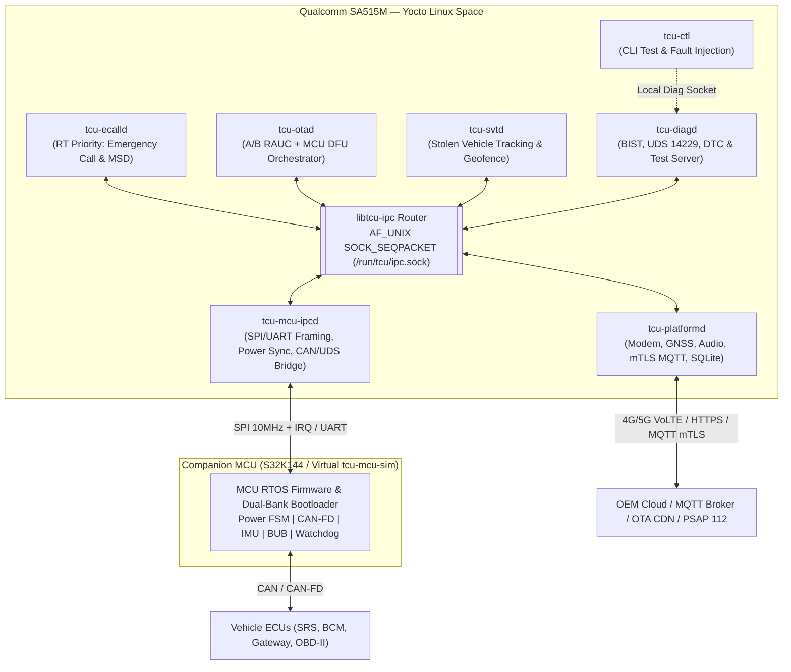
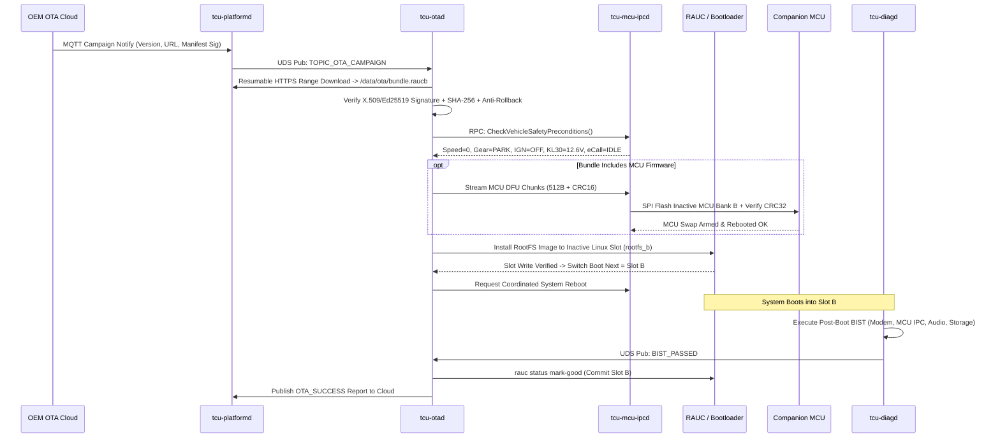
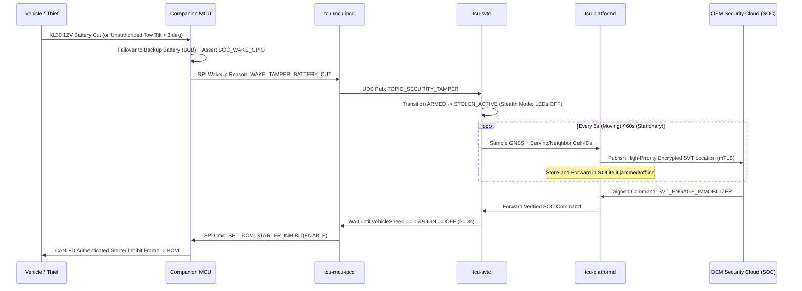

# System Design Document (SDD)
## Project: Automotive Telematics Control Unit (TCU) on Yocto Linux (SA515M + Companion MCU)

---

## 1. Architectural Philosophy: Dual-Domain + Multi-Process 3-Layer Standard

In alignment with automotive embedded engineering standards (ASPICE SWE.2, ISO 26262 freedom-from-interference principles, UN R144 eCall, and UN R156 SUMS), the TCU is architected across **Two Hardware Compute Domains** and **Three Software Abstraction Layers**:

```text
+================================================================================+
| DOMAIN 1: QUALCOMM SA515M SoC (Yocto Linux — Multi-Process Protected Space)    |
|                                                                                |
|  +--------------------------------------------------------------------------+  |
|  | TIER 1: FEATURE & ORCHESTRATION DAEMONS (Business Logic & State Machines)|  |
|  |  [tcu-ecalld]     [tcu-otad]     [tcu-svtd]     [tcu-diagd]   [tcu-ctl]  |  |
|  +------------------------------------^-------------------------------------+  |
|                                       | Intra-SoC IPC: UDS (SOCK_SEQPACKET)    |
|                                       | & D-Bus via libtcu-ipc                 |
|  +------------------------------------v-------------------------------------+  |
|  | TIER 2: PLATFORM DAEMONS & DOMAIN SERVICES (Hardware-Independent Logic)  |  |
|  |  [tcu-platformd: ModemService, GnssService, CloudService, StorageService]|  |
|  |  [tcu-mcu-ipcd : McuProtocolService, PowerCoordinator, CanSignalRouter]  |  |
|  +------------------------------------^-------------------------------------+  |
|                                       | Pure Virtual C++17 Interfaces Only     |
|  +------------------------------------v-------------------------------------+  |
|  | TIER 3: HARDWARE ABSTRACTION LAYER (HAL)                                 |  |
|  |  IMcuIpcHAL | IModemHAL | IGnssHAL | IAudioHAL | IOtaBootHAL | ICryptoHAL|  |
|  |  -> Concrete SA515M HALs (QMI, ALSA, spidev, RAUC, OpenSSL)              |  |
|  |  -> Concrete Mock/QEMU HALs (PTY Virtual MCU, vcan0, Simulated Modem)    |  |
|  +------------------------------------^-------------------------------------+  |
+=======================================|========================================+
                                        | Inter-Processor IPC:
                                        | SPI (10 MHz + IRQ) & UART (CRC-16)
+=======================================v========================================+
| DOMAIN 2: COMPANION VEHICLE MCU (NXP S32K144 / STM32G4 — RTOS / Bare-Metal)    |
|  - Power Master FSM (KL15, Sleep/Wake, BUB Failover)                           |
|  - CAN / CAN-FD Stack + ISO-TP UDS Bridge + Selective Wakeup                   |
|  - Airbag Crash Input, SOS Button/LED, 6-Axis IMU (Crash/Tow), Ext. Watchdog   |
|  - Dual-Bank Flash Bootloader (Atomic MCU OTA Swap & Rollback)                 |
+=======================================^========================================+
                                        | CAN 2.0B / CAN-FD
                                        v
                   [Vehicle Gateway | SRS Airbag | BCM | Immobilizer]
```

### Strict Architectural Invariants:
1. **Process Isolation for Safety Criticality**: Crash or restart of `tcu-otad` or `tcu-svtd` **cannot** corrupt memory or block `tcu-ecalld`. Each feature runs in an isolated POSIX process supervised by `systemd` cgroups and watchdogs.
2. **Three Distinct Communication Boundaries**:
   * **Intra-SoC IPC (`libtcu-ipc` over UDS / D-Bus)**: Connects Linux processes inside SA515M (`< 50 µs` latency).
   * **Inter-Processor IPC (SPI / UART Binary Protocol)**: Connects SA515M to Companion MCU using sequence-numbered, `CRC-16-CCITT` protected frames.
   * **In-Vehicle Network (CAN / CAN-FD)**: Connects Companion MCU to vehicle ECUs.
3. **Zero Hardware Leakage Above HAL**: No Linux kernel `ioctl`, QMI header, ALSA call, or RAUC D-Bus call is permitted inside Tier 1 (`daemons/`) or Tier 2 (`service/`). Swapping `Sa515mHAL` for `MockHAL` enables 100% deterministic execution on x86_64 Host PCs and `qemuarm64`.

---

## 2. Multi-Process Topology & IPC Data Flow



---

## 3. End-to-End Feature Sequence Flows

### 3.1 Emergency Call (eCall) Crash Sequence
```mermaid
sequenceDiagram
    participant SRS as Airbag ECU (CAN)
    participant MCU as Companion MCU
    participant IPCD as tcu-mcu-ipcd
    participant ECALL as tcu-ecalld
    participant PLAT as tcu-platformd
    participant PSAP as 112 PSAP Operator

    SRS->>MCU: CAN Crash Pulse + Discrete Crash PWM
    MCU->>MCU: Verify IMU delta-V & Switch to BUB if KL30 Cut
    MCU->>IPCD: SPI IRQ Frame: EVT_CRASH_DETECTED (Airbag + DeltaV)
    IPCD->>ECALL: UDS Urgent Pub: TOPIC_EMERGENCY_TRIGGER
    ECALL->>PLAT: RPC: PreemptNetworkAndAudio(LOCK_EMERGENCY)
    ECALL->>PLAT: RPC: GetLatestGnssFixWithHistory(N, N-1, N-2)
    PLAT-->>ECALL: GnssFixTrail + VIN
    ECALL->>ECALL: Encode 140-byte CEN EN 15722 MSD
    ECALL->>PLAT: RPC: DialEmergencyCall("112", MSD_Payload)
    PLAT->>PSAP: VoLTE / CS 112 Call Setup + In-Band/SIP MSD TX
    PSAP-->>PLAT: MSD LL-ACK + HL-ACK
    PLAT-->>ECALL: EVT_MSD_ACKNOWLEDGED
    ECALL->>PLAT: RPC: SetVoiceAudioRoute(CABIN_MIC_SPEAKER_UNMUTE)
    PSAP<-->PLAT: Two-Way Cabin Voice Conversation
```

### 3.2 Full Automotive OTA Sequence (A/B Linux RootFS + Companion MCU DFU)


### 3.3 Stolen Vehicle Tracking (SVT) Sequence


---

## 4. Storage Partition Layout (Dual-Bank A/B eMMC / QEMU `.wic`)

To guarantee brick-free OTA updates across power loss, the 4 GB eMMC (and `qemuarm64` virtual disk) uses a redundant GPT layout:

| Partition | Label | Size | Filesystem | Access Mode | Purpose |
|---|---|---|---|---|---|
| `p1` | `boot_env` | `16 MB` | Raw / FAT | R/W (Atomic) | Bootloader (`U-Boot` / `ABL`) redundant environment & slot boot counters |
| `p2` | `boot_a` | `64 MB` | `ext4` / FIT | Read-Only | Signed Linux Kernel + DTB + Initramfs (Slot A) |
| `p3` | `boot_b` | `64 MB` | `ext4` / FIT | Read-Only | Signed Linux Kernel + DTB + Initramfs (Slot B) |
| `p4` | `rootfs_a` | `768 MB` | `squashfs` / `ext4` | Read-Only (`dm-verity`) | Yocto RootFS + TCU Daemons (Slot A) |
| `p5` | `rootfs_b` | `768 MB` | `squashfs` / `ext4` | Read-Only (`dm-verity`) | Yocto RootFS + TCU Daemons (Slot B) |
| `p6` | `factory` | `64 MB` | `ext4` | Read-Only | Device VIN, X.509 mTLS provisioning certs, Audio/IMU calibration |
| `p7` | `data` | `2.2 GB` | `ext4` (journaled) | Read-Write | SQLite WAL databases (`/data/db/`), OTA staging (`/data/ota/`), persistent DTCs & logs |

---

## 5. System Memory, CPU & Latency Budget (SA515M 512 MB LPDDR4X)

| Component / Process | Target RAM (RSS) | Avg CPU Load | Real-Time / Latency SLA |
|---|---|---|---|
| **Yocto Base OS + Kernel + QMI/Network** | `95 MB` | `3% – 5%` | Cold boot `< 6.0 s` |
| **`tcu-mcu-ipcd`** (SPI/UART + Power) | `8 MB` | `2% – 4%` | Crash/Wake IRQ propagation **`< 5 ms`** |
| **`tcu-ecalld`** (`SCHED_FIFO` prio 80) | `10 MB` | `< 0.5%` (idle) / `5%` (call) | Crash trigger to Dial `112` **`< 100 ms`** |
| **`tcu-platformd`** (Modem/GNSS/MQTT/DB) | `28 MB` | `3% – 6%` | GNSS 10 Hz parse `< 2 ms`; SQLite batch `< 5 ms` |
| **`tcu-svtd`** (Geofence & Anti-Theft) | `8 MB` | `< 1%` | Geofence & tamper evaluation `< 2 ms` |
| **`tcu-otad`** (RAUC + Streaming Verify) | `32 MB` (peak) | `< 1%` (idle) / `25%` (verify)| Streaming SHA-256 (`64 KB` chunks, bounded RAM) |
| **`tcu-diagd`** (BIST + UDS ISO 14229) | `10 MB` | `< 1%` | UDS `P2_Server_Max` response **`< 50 ms`** |
| **Total Allocated** | **`~191 MB` Peak** | **`~10% – 18%` Normal** | **Free RAM Headroom: `> 320 MB` (`> 62%`)** |

---

## 6. Related Design Specifications
* 📐 **[Architecture Summary (Vietnamese)](tcu_architecture_overview.md)**: Tóm tắt toàn cảnh kiến trúc SA515M + MCU, phân biệt IPC và Power Management.
* 🧩 **[High-Level Design (HLD)](high_level_design.md)**: Đặc tả trách nhiệm từng daemon, giao thức IPC topics/RPC và quy tắc chiếm quyền ưu tiên.
* 💻 **[Software Design (SWDD)](software_design.md)**: Cấu trúc gói mã nguồn C++17, Dependency Injection, Pure Virtual HALs và Mock Simulator.
* 🔬 **[Low-Level Design (LLD)](low_level_design.md)**: Khung nhị phân SPI CRC-16, chuẩn MSD 140-byte EN 15722, FSM của OTA/SVT, bảng mã UDS và SQLite Schema.
* 🧵 **[Multi-Process & Threading Model (Vietnamese)](threading_model.md)**: Mô hình đa tiến trình, phân bổ POSIX threads, `SCHED_FIFO` cho eCall và Watchdog 2 tầng.
* ⚡ **[System Operational Workflows (Vietnamese)](system_workflow.md)**: Phân tích từng bước mili-giây cho 5 kịch bản vận hành cốt lõi của TCU.
