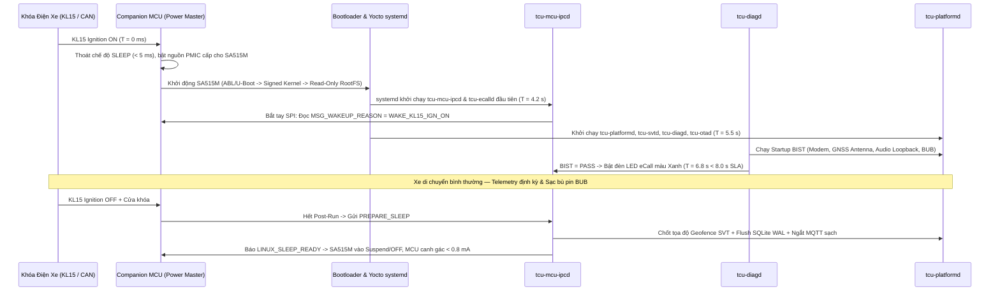
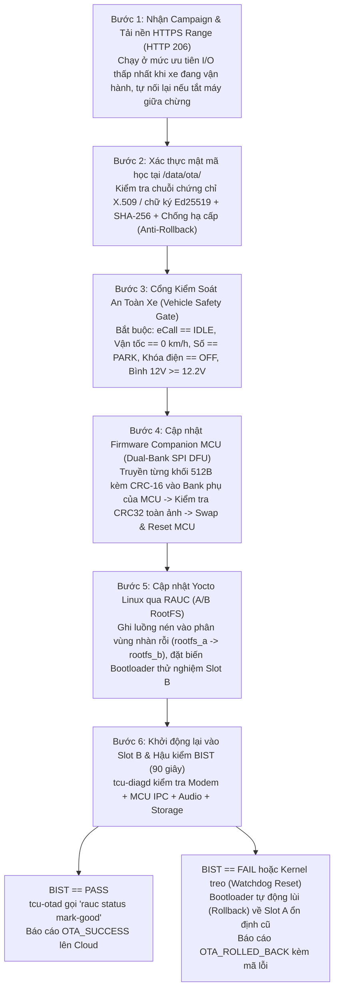

# Đặc Tả Luồng Vận Hành Hệ Thống Chi Tiết (System Operational Workflows)
## Phân Tích Từng Bước Tương Tác Giữa SA515M, Companion MCU, RAM, Flash & Mạng Viễn Thông

Tài liệu này mô tả chi tiết **5 luồng vận hành nghiệp vụ cốt lõi** của hệ thống TCU trên nền tảng Yocto Linux, chỉ rõ tại từng bước: **Miền xử lý nào (MCU hay SA515M)**, **Daemon / Thread nào thực thi**, **Tác động lên Nguồn / RAM / Flash** và **Cam kết độ trễ (Timing SLA)**.

---

## 1. Luồng 1: Khởi Động (Ignition ON), Vận Hành & Chuyển Ngủ Tiết Kiệm Điện (Power Lifecycle)

---

## 2. Luồng 2: Cuộc Gọi Khẩn Cấp Tự Động Khi Tai Nạn — eCall (`tcu-ecalld`)

Đây là luồng có mức độ ưu tiên an toàn sinh mạng cao nhất (**P0 — Safety Critical**), kể cả khi va chạm làm đứt cáp ắc-quy 12V của xe:

| Mốc Thời Gian | Thành Phần Thực Thi | Hành Vi Chi Tiết Trên Phần Cứng & Phần Mềm | Trạng Thái Nguồn & Bộ Nhớ |
|---|---|---|---|
| **`T = 0 ms`** | Airbag SRS $\to$ **MCU** | Túi khí bung phát đồng thời khung CAN `SRS_CRASH` và xung PWM phần cứng vào chân ngắt của MCU; IMU trên TCU ghi nhận xung giảm tốc $\Delta V = -48\text{ km/h}$. | Nếu cáp bình `KL30 12V` bị đứt (`< 6V`), mạch nguồn chuyển mạch phần cứng `< 1 ms` sang **Pin dự phòng BUB**. |
| **`T = 2 ms`** | **MCU** $\to$ `tcu-mcu-ipcd` | MCU kéo chân ngắt `MCU_INT_GPIO` và truyền khẩn qua SPI bản tin `MSG_CRASH_EVENT` (kèm cờ `URGENT_WAKE` & CRC-16). | Luồng `mcu-spi-trx` (`SCHED_FIFO 70`) thức dậy tức thì. |
| **`T = 5 ms`** | `tcu-mcu-ipcd` $\to$ **`tcu-ecalld`** | Phát bản tin khẩn `TOPIC_EMERGENCY_TRIGGER` qua Unix Domain Socket tới `tcu-ecalld`. | Luồng `ecall-fsm-rt` (`SCHED_FIFO 80`) chiếm quyền CPU. |
| **`T = 12 ms`** | **`tcu-ecalld`** $\to$ `tcu-platformd` & `otad` | Giữ `WakeLock(EMERGENCY)`, phát lệnh **Preempt**: hủy ngay mọi tiến trình tải OTA hoặc đồng bộ dữ liệu nền, khóa độc quyền Modem và Audio Codec; đổi đèn LED eCall sang nhấp nháy thông báo. | Giải phóng hoàn toàn băng thông mạng di động cho cuộc gọi khẩn cấp. |
| **`T = 25 ms`** | **`tcu-ecalld`** | Truy xuất tọa độ GNSS hợp lệ mới nhất cùng 2 điểm lịch sử (`N-1`, `N-2`), số khung `VIN`, loại nhiên liệu và hướng di chuyển; đóng gói mảng nhị phân **140-byte MSD chuẩn CEN EN 15722**. | Tiêu tốn `< 4 KB` bộ nhớ Stack tĩnh (không cấp phát động tránh phân mảnh). |
| **`T = 65 ms`** | **`tcu-ecalld`** $\to$ `IModemHAL` | Phát lệnh quay số khẩn cấp `112` (cờ `TS 122.101 Emergency Setup` — kết nối qua bất kỳ trạm BTS nhà mạng nào có sóng dù không đăng ký roaming). | **Đạt chuẩn SLA `< 100 ms` từ lúc va chạm đến lúc phát lệnh quay số!** |
| **`T = 3.5 s`** | Modem $\to$ Tổng đài **PSAP** | Cuộc gọi kết nối; Modem truyền gói 140-byte MSD (qua In-band Modem hoặc SIP INFO với NG-eCall) và nhận xác nhận `LL-ACK` + `HL-ACK` từ tổng đài viên. | Nếu quá `20 giây` không nhận được ACK dữ liệu, tự động chuyển sang thoại để không mất liên lạc cứu hộ. |
| **`T = 6.0 s`** | **`tcu-ecalld`** $\to$ `IAudioHAL` | Mở tuyến PCM 2 chiều kết nối Microphone & Loa cabin với khử vọng âm (AEC) để nạn nhân nói chuyện trực tiếp với nhân viên cứu hộ PSAP. | Pin BUB đảm bảo tối thiểu `>= 10 phút` đàm thoại liên tục + định vị GNSS. |
| **Sau cuộc gọi**| **`tcu-ecalld`** | Khi PSAP gác máy, duy trì trạng thái **Callback Standby suốt 60 phút**: tự động bắt máy (`Auto-Answer`) và mở mic/loa nếu tổng đài cứu hộ gọi ngược lại. | Chỉ giải phóng `WakeLock` sau khi hết cửa sổ 60 phút. |

---

## 3. Luồng 3: Cập Nhật Phần Mềm Toàn Diện — Full Automotive OTA (`tcu-otad`)

Kịch bản nâng cấp đồng thời cả **Firmware Companion MCU** và **Hệ điều hành Yocto Linux A/B RootFS** với cam kết không bao giờ biến thiết bị thành "cục gạch" (Zero-Brick Atomic Update):

---

## 4. Luồng 4: Theo Dõi & Thu Hồi Xe Mất Cắp — Stolen Vehicle Tracking (`tcu-svtd`)

1. **Tự động kích hoạt canh gác (`ARMED`)**: Ngay khi xe đỗ (`Speed = 0`, `KL15 = OFF`, `Doors = LOCKED`), `tcu-svtd` lưu tọa độ gốc $(\phi_0, \lambda_0)$ với bán kính hàng rào địa lý `100 m`, sau đó SA515M đi ngủ để tiết kiệm điện.
2. **Phát hiện xâm phạm & Chuyển nguồn BUB tàng hình (`STOLEN_ACTIVE`)**:
   * **Trường hợp A (Kẻ gian cắt bình ắc-quy 12V)**: Điện áp `KL30` sụt dưới `6.0V` $\to$ MCU chuyển tức thì sang **Pin dự phòng BUB**, kéo chân đánh thức SA515M kèm mã `WAKE_TAMPER_BATTERY_CUT`.
   * **Trường hợp B (Xe bị cẩu kéo lên xe sàn trượt khi tắt máy)**: Cảm biến IMU trên MCU phát hiện góc nghiêng thay đổi `> 3.0°` hoặc rung động kéo dài không có chìa khóa hợp lệ $\to$ đánh thức SA515M kèm mã `WAKE_IMU_TOW_TILT`.
3. **Truy vết ngầm & Lưu vết ngoại tuyến (Covert Tracking)**:
   * TCU **tuyệt đối không bật đèn LED hay phát tiếng kêu** trong cabin để tránh bị kẻ trộm phát hiện tháo gỡ.
   * Bật GNSS `10 Hz` kết hợp quét danh sách trạm phát sóng di động xung quanh (`Serving + Neighbor Cell-IDs` để định vị tương đối ngay cả khi xe bị giấu trong container/tầng hầm chắn sóng GPS).
   * Bắn gói tin định vị mã hóa lên trung tâm an ninh OEM SOC mỗi **5 giây** khi xe di chuyển (tự động giãn thành **60 giây** khi xe đứng yên trên nguồn BUB để kéo dài thời gian sống trên `24 giờ`). Nếu đi vào vùng mất sóng di động, toàn bộ hành trình được mã hóa ghi vào bảng `telemetry_queue` trong SQLite và đẩy bù ngay khi có sóng lại.
4. **Khóa khởi động từ xa có khóa liên động an toàn (Zero-Speed Safe Immobilizer)**:
   * Khi chủ xe và cảnh sát xác nhận mất xe, Cloud SOC gửi lệnh có chữ ký số `SVT_ENGAGE_IMMOBILIZER`.
   * Nếu xe đang chạy (`Speed > 0`), `tcu-svtd` giữ ở trạng thái `IMMOBILIZE_PENDING` (**tuyệt đối không ngắt động cơ khi xe đang lăn bánh** để tránh tai nạn giao thông).
   * Ngay khi kẻ trộm dừng xe và tắt máy (`Speed == 0 km/h` và `KL15 == OFF` liên tục `>= 3 giây`), cả `tcu-svtd` và phần cứng MCU cùng xác nhận điều kiện an toàn rồi mới phát lệnh CAN khóa bộ đề xuống BCM, ngăn xe nổ máy trở lại.

---

## 5. Luồng 5: Dịch Vụ Kiểm Thử & Chẩn Đoán — Test Service (`tcu-diagd` & `tcu-ctl`)

Luồng này phục vụ 3 giai đoạn: **Tự kiểm tra trên xe (On-board BIST)**, **Chẩn đoán tại xưởng dịch vụ / dây chuyền nhà máy (EOL UDS ISO 14229)** và **Kiểm thử tự động phần mềm (CI/SIL/HIL Fault Injection)**:

1. **Tự kiểm tra định kỳ (Periodic BIST — mỗi 30 giây)**:
   * Kiểm tra kết nối SPI tới MCU, cường độ sóng Modem/SIM, dòng tiêu thụ ăng-ten chủ động GNSS (`2 mA .. 45 mA`), nội trở và dung lượng pin BUB (`SoH >= 70%`), và phát xung kiểm tra khép kín Codec âm thanh eCall.
   * Nếu phát hiện đứt dây ăng-ten GNSS, `tcu-diagd` lập tức ghi mã lỗi bền vững `B1A01-13` vào bảng `dtc_records` kèm dữ liệu đóng băng (Freeze Frame: điện áp, nhiệt độ, vận tốc) và ra lệnh cho MCU đổi đèn LED eCall sang màu **Đỏ cảnh báo** theo luật UN R144.
2. **Phục vụ máy chẩn đoán UDS qua cổng OBD-II / CAN (`ISO 14229`)**:
   * Kỹ thuật viên cắm máy chẩn đoán gửi `0x22 FD 03` $\to$ MCU gom khung ISO-TP đẩy qua SPI lên `tcu-diagd` $\to$ trả về điện áp `KL30`, `BUB mV`, `SoC%`, `SoH%` trong vòng **`< 15 ms`** (vượt xa yêu cầu `P2_Server < 50 ms`).
   * Kỹ thuật viên gửi `0x31 01 02 01` (**Routine: Start Test eCall**) $\to$ `tcu-diagd` kích hoạt `tcu-ecalld` với cờ `test_call = true` quay số tới tổng đài kiểm thử tự động thay vì số khẩn cấp `112`.
3. **Tiêm sự kiện giả lập qua `tcu-ctl` (Phục vụ Dev & CI/QEMU)**:
   * Trên Host PC hoặc máy ảo Yocto `qemuarm64`, kỹ sư chạy lệnh `tcu-ctl inject crash --delta-v 50` hoặc `tcu-ctl inject tamper --kl30-cut` để kiểm chứng đầu-cuối toàn bộ các máy trạng thái eCall, SVT và OTA mà không cần phá hủy phần cứng thật.

---

## 6. Ma Trận Tổng Hợp Tài Nguyên & Cam Kết Thời Gian (Resource & SLA Matrix)

| Kịch Bản Vận Hành | Tiến Trình Chủ Đạo | CPU Load | RAM Chiếm Dụng | Nguồn Cung Cấp | Mức Tiêu Thụ Điện @ 12V | Cam Kết Độ Trễ (SLA) |
|---|---|---|---|---|---|---|
| **Đỗ xe ngủ sâu (Deep Sleep)** | Chỉ **MCU** chạy (Linux OFF) | `0%` (SoC) | `0 MB` (SoC OFF) | Bình 12V `KL30` | **`< 0.8 mA`** | Đánh thức MCU `< 50 ms`, Boot Linux `< 8 s` |
| **Chạy bình thường (Normal Cruise)**| `mcu-ipcd`, `platformd`, `diagd`| `8% – 14%` | `~145 MB` tổng | Bình 12V `KL30` | `75 mA – 110 mA` | Chu kỳ CAN `10 Hz`, GNSS `1 Hz`, UDS `< 50 ms` |
| **Tai nạn khẩn cấp (Active eCall)** | **`tcu-ecalld` (`FIFO 80`)** | `15% – 22%`| `~155 MB` tổng | `KL30` hoặc **Pin BUB** | `350 mA – 600 mA` | Phát hiện va chạm $\to$ Quay số `112` **`< 100 ms`** |
| **Truy vết mất cắp (SVT Active)** | **`tcu-svtd`**, `platformd` | `10% – 16%`| `~150 MB` tổng | `KL30` hoặc **Pin BUB** | `180 mA` (chạy) / `15 mA` (đứng yên)| Phát hiện cắt bình $\to$ Bắn cảnh báo **`< 3 s`** |
| **Nâng cấp hệ thống (Full OTA)** | **`tcu-otad`**, `rauc`, `mcu-ipcd`| `25% – 40%`| `~191 MB` đỉnh | Bình 12V (`>= 12.2V`) | `220 mA – 400 mA` | Cài đặt Slot B `< 3 phút`, Hậu kiểm BIST `< 90 s` |
