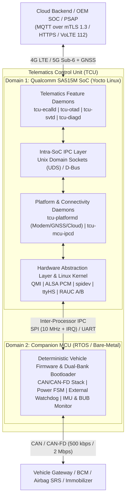
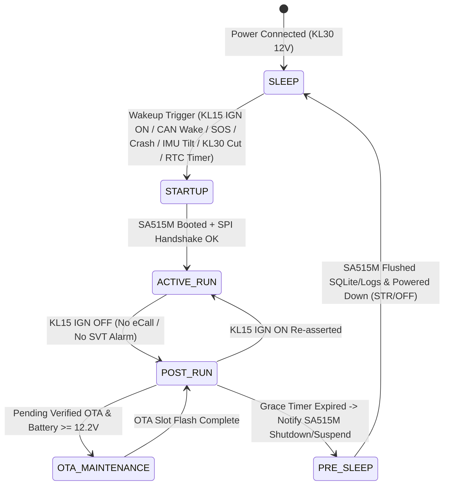

# Tổng Quan Kiến Trúc Tham Khảo Hệ Thống TCU (Qualcomm SA515M + Companion MCU)
## Nền Tảng Yocto Linux Cho eCall, Full OTA, Stolen Vehicle Tracking & Test Service

Tài liệu này tổng hợp và chuẩn hóa toàn bộ kiến trúc hệ thống **Telematics Control Unit (TCU)** dựa trên mô hình **Dual-Compute Domain (Qualcomm SA515M + Companion MCU)**, đồng thời ánh xạ trực tiếp vào kiến trúc phần mềm Yocto Linux của dự án với 4 nhóm tính năng cốt lõi: **eCall**, **Full Automotive OTA**, **Vehicle Stolen Tracking (SVT)** và **Test Service (Diagnostics & Fault Injection)**.

---

## 1. Triết Lý Kiến Trúc Hai Miền Tính Toán (Dual-Compute Domain)

Trong một hệ thống TCU chuẩn công nghiệp ô tô (OEM / Tier-1), việc kết hợp **Application/Modem SoC (Qualcomm SA515M)** và **Companion Vehicle MCU (ví dụ NXP S32K144 / STM32G4)** giải quyết hai bài toán kỹ thuật có bản chất hoàn toàn trái ngược nhau:



### 1.1 Vai trò của Qualcomm SA515M (High-Level Connectivity & Compute Domain)
SA515M chạy **Yocto Linux**, cung cấp không gian bộ nhớ ảo, cô lập tiến trình (process isolation), ngăn xếp mạng TCP/IP, thư viện mật mã (OpenSSL / HSM) và hệ thống tệp tin bền vững:
* **Cellular & Voice**: Quản lý kết nối dữ liệu 4G/5G, cuộc gọi khẩn cấp VoLTE / CS Voice cho eCall và truyền gói tin MSD.
* **GNSS Positioning**: Thu nhận tọa độ đa hệ vệ tinh (GPS, Galileo, GLONASS, BeiDou), tính toán vận tốc hướng di chuyển và lưu vết dead-reckoning.
* **Cloud & Security**: Duy trì kết nối MQTT mTLS hai chiều, tải gói cập nhật HTTPS Range Request, xác thực chữ ký số gói OTA (X.509 / Ed25519).
* **High-Level Telematics Applications**: Chạy máy trạng thái nghiệp vụ phức tạp cho **eCall**, **OTA Orchestrator (A/B RootFS + MCU DFU)**, **Stolen Vehicle Tracking** và **Diagnostic / Test Server**.

### 1.2 Vai trò của Companion MCU (Deterministic, Vehicle-Facing & Ultra-Low-Power Domain)
MCU chạy RTOS hoặc Bare-metal gắn trực tiếp với mạng nội bộ xe và mạch nguồn của TCU:
* **Giao tiếp mạng xe (CAN / CAN-FD)**: Đọc/gửi frame CAN thời gian thực xác định (deterministic latency `< 2 ms`), lọc tín hiệu vận tốc xe, trạng thái khóa điện KL15 (Ignition), tín hiệu bung túi khí (Airbag Crash SRS) và chuyển tiếp bản tin chẩn đoán UDS ISO-TP.
* **Quản lý nguồn năng lượng (Power Management)**: Duy trì dòng tiêu thụ tĩnh cực thấp (`< 100 µA` đến `< 1 mA`) khi xe tắt máy (Ignition OFF) trong nhiều tuần mà không làm cạn ắc-quy 12V của xe — điều mà SoC Linux không thể tự đảm nhiệm nếu thức liên tục.
* **Giám sát an toàn độc lập (Watchdog & Tamper Sensing)**: Giám sát nhịp tim (heartbeat) của SA515M để hard-reset SoC khi treo kernel; đọc cảm biến gia tốc IMU 6 trục (va chạm, cẩu kéo xe trái phép) và giám sát điện áp ắc-quy chính KL30 / pin dự phòng **BUB (Backup Battery)**.

---

## 2. Quản Lý Nguồn & Chu Trình Ngủ / Đánh Thức (Power State Machine)

Khi xe tắt máy (`Ignition OFF`), TCU không được phép tiêu thụ điện như lúc xe đang vận hành. MCU đóng vai trò là **Power Master** điều phối trạng thái nguồn của toàn bộ TCU:



* **Các nguồn đánh thức (Wakeup Sources) quan trọng cho tính năng dự án**:
  1. `IGNITION_ON (KL15)`: Khởi động chu trình lái xe bình thường.
  2. `CRASH_SIGNAL / SOS_BUTTON`: Đánh thức khẩn cấp SA515M ngay lập tức để kích hoạt **eCall**.
  3. `IMU_MOTION_TILT / BUB_BATTERY_CUT`: Phát hiện xe bị nâng/kéo trộm hoặc bị cắt bình 12V khi đang đỗ $\to$ chuyển sang nguồn pin dự phòng BUB, đánh thức SA515M ở chế độ ngầm (Stealth Mode) để kích hoạt **Stolen Vehicle Tracking**.
  4. `MODEM_RING / SMS_WAKE`: Đánh thức SA515M từ phía mạng di động (Wake-on-WAN) khi trung tâm điều hành OEM SOC gửi lệnh truy vết xe mất cắp hoặc kiểm tra trạng thái từ xa.
  5. `RTC_PERIODIC_TIMER`: Đánh thức định kỳ (ví dụ mỗi 24 giờ) để gửi bản tin sức khỏe bình điện hoặc kiểm tra chiến dịch **OTA**.

---

## 3. Phân Biệt Rõ 3 Tầng Giao Tiếp (IPC vs Inter-Processor vs Vehicle Bus)

Một sai lầm phổ biến khi thiết kế hệ thống Automotive là nhầm lẫn giữa IPC nội bộ hệ điều hành với giao tiếp liên vi xử lý. Kiến trúc dự án tách bạch **3 tầng truyền thông độc lập**:

| Tầng Giao Tiếp | Phạm Vi Kết Nối | Công Nghệ Trong Yocto Linux | So Sánh Với Android Automotive | Đặc Điểm Kỹ Thuật |
|---|---|---|---|---|
| **1. Intra-SoC IPC** | Tiến trình A $\leftrightarrow$ Tiến trình B bên trong SA515M | **Unix Domain Sockets (`SOCK_SEQPACKET`)** / **D-Bus** | Tương đương **Android Binder** | Chia sẻ cùng Kernel Linux, độ trễ `< 50 µs`, định tuyến Pub/Sub & RPC có phân quyền |
| **2. Inter-Processor IPC** | SA515M (Linux) $\leftrightarrow$ Companion MCU (RTOS) | **SPI (10 MHz + GPIO IRQ)** & **UART (921.6 kbps)** | Giống nhau (HAL/Service nói chuyện với MCU qua SPI/UART) | Khác vi xử lý, khác không gian bộ nhớ; bắt buộc đóng gói khung nhị phân có `SeqNum`, `ACK/NACK` và `CRC-16` |
| **3. Vehicle Network** | Companion MCU $\leftrightarrow$ Các ECU trên xe | **CAN 2.0B / CAN-FD** (+ ISO-TP cho UDS) | Giống nhau (MCU làm cầu nối xuống CAN bus) | Chịu nhiễu điện từ trường ô tô, ưu tiên khung tin theo Arbitration ID thời gian thực |

### Ví dụ luồng dữ liệu xuyên suốt (Đọc vận tốc xe `VehicleSpeed` cho SVT & OTA Safety Check):
```text
[Vehicle Gateway ECU]
   │  CAN Frame (ID 0x120: VehicleSpeed = 80.5 km/h)
   ▼
[Companion MCU]
   │  Đóng gói Binary Frame: [SOF=0xAA55][MsgID=0x11][Seq][Len][Speed=8050][CRC16]
   │  Truyền vật lý qua bus SPI / UART
   ▼
[SA515M Kernel Driver: /dev/spidev0.0]
   │  Đọc bởi HAL (Sa515mMcuIpcHAL)
   ▼
[Daemon: tcu-mcu-ipcd]
   │  Phát sự kiện nội bộ qua Unix Domain Socket (Intra-SoC IPC)
   ▼
[Daemons: tcu-otad / tcu-svtd / tcu-ecalld]
   └─► tcu-otad khóa không cho phép flash OTA vì xe đang chạy (> 0 km/h)
```

---

## 4. Kiến Trúc Yocto Linux & Phân Bổ 4 Tính Năng Cốt Lõi Của Dự Án

Hệ điều hành trên SA515M (và bản mô phỏng `qemuarm64`) được đóng gói hoàn toàn từ mã nguồn bằng **Yocto Project**, kết hợp các layer:
* `poky` (Core build system & toolchain)
* `meta-qti-bsp` (Production SA515M BSP) hoặc `qemuarm64` BSP (Môi trường mô phỏng kiểm thử đầy đủ)
* `meta-openembedded` (`meta-oe`, `meta-networking`, `meta-python`)
* `meta-rauc` (Quản lý phân vùng kép A/B RootFS Atomic Update & Rollback)
* `meta-tcu-telematics` (Custom layer của dự án chứa toàn bộ 6 daemons C++17, công cụ `tcu-ctl`, cấu hình systemd và phân vùng image)

### Bản đồ ánh xạ 4 tính năng mục tiêu trên hai miền SA515M + MCU:

| Tính Năng | Trách Nhiệm Phía MCU | Trách Nhiệm Phía SA515M (Yocto Linux Daemons) |
|---|---|---|
| **1. eCall (`tcu-ecalld`)** | Nhận xung va chạm túi khí CAN SRS + gia tốc kế IMU, lọc chống nhiễu nút bấm vật lý SOS, chuyển nguồn sang pin BUB nếu mất nguồn 12V, đánh thức SA515M tức thì | Chiếm quyền ưu tiên cao nhất (`SCHED_FIFO`), thu thập tọa độ GNSS mới nhất + 2 điểm lịch sử, mã hóa bản tin **MSD 140-byte (EN 15722)**, quay số khẩn cấp 112 (VoLTE/CS), truyền MSD và mở luồng âm thanh đàm thoại 2 chiều tới tổng đài PSAP |
| **2. Full OTA (`tcu-otad`)** | Kiểm tra điện áp bình 12V & trạng thái xe đỗ (`PARK`, `Speed = 0`), nhận từng phân đoạn firmware mới qua SPI vào Dual-Bank Flash của MCU, kiểm tra CRC32 và kích hoạt bootloader swap | Tải gói cập nhật qua HTTPS hỗ trợ resume, xác thực chữ ký mật mã Ed25519/RSA-2048, ghi image Linux mới sang phân vùng nhàn rỗi (`rootfs_a` $\leftrightarrow$ `rootfs_b`) qua **RAUC**, điều phối nạp firmware MCU qua `tcu-mcu-ipcd`, tự động rollback nếu hậu kiểm khởi động thất bại |
| **3. Stolen Vehicle Tracking (`tcu-svtd`)** | Canh gác ở chế độ siêu tiết kiệm điện (`SLEEP`): phát hiện nghiêng/kéo xe qua IMU, phát hiện cắt cáp ắc-quy 12V để chuyển sang BUB, thực thi lệnh khóa đề (Immobilizer Inhibit) xuống BCM **chỉ khi vận tốc xe = 0 km/h** | Xác thực cảnh báo mất cắp, kiểm tra vi phạm hàng rào địa lý (**Geofence**), kích hoạt chế độ theo dõi ngầm (tắt đèn/âm thanh, bắn tọa độ GPS + Cell-ID mỗi 5 giây qua MQTT mTLS), lưu vết ngoại tuyến vào SQLite khi vào hầm mất sóng |
| **4. Test Service (`tcu-diagd` & `tcu-ctl`)** | Phản hồi bài tự kiểm tra (BIST) phần cứng MCU/CAN/BUB, định tuyến khung chẩn đoán **UDS (ISO 14229)** từ cổng OBD-II/CAN lên Linux | Chạy tự kiểm tra định kỳ (Modem, SIM, Ăng-ten GNSS, Loopback Mic/Loa cho eCall, độ chai pin BUB), lưu/đọc mã lỗi **DTC**, phục vụ các dịch vụ UDS (`0x10`, `0x22`, `0x19`, `0x31` eCall Test Call) và cung cấp CLI `tcu-ctl` tiêm sự kiện giả lập phục vụ kiểm thử tự động |

---

## 5. Mô Hình Tư Duy Chuẩn Hóa (Mental Model Dành Cho Thiết Kế & Triển Khai)

Khi đọc hoặc mở rộng toàn bộ tài liệu thiết kế trong thư mục `docs/`, luôn bám sát chuỗi phân lớp từ trên xuống dưới sau:

```text
[OEM Cloud / PSAP]
        ▲
        │  MQTT over mTLS 1.3 / HTTPS Range / VoLTE Emergency Call
        ▼
[SA515M Yocto Linux: Feature Daemons]  (tcu-ecalld, tcu-otad, tcu-svtd, tcu-diagd)
        ▲
        │  Unix Domain Sockets (UDS) / D-Bus  <-- Intra-Processor IPC (giữa các Linux Processes)
        ▼
[SA515M Yocto Linux: Platform Daemons] (tcu-platformd, tcu-mcu-ipcd)
        ▲
        │  3-Layer Pure Virtual HAL Interfaces (Sa515m Concrete HAL vs Host/QEMU Mock HAL)
        ▼
[Linux Kernel Drivers]                 (spidev, ttyHS, QMI/ModemManager, ALSA, SocketCAN, RAUC)
        ▲
        │  SPI (10 MHz + IRQ) / UART          <-- Inter-Processor IPC (giữa SA515M và MCU, có CRC-16)
        ▼
[Companion MCU Firmware]               (Power FSM, External Watchdog, IMU, BUB, Dual-Bank Bootloader)
        ▲
        │  CAN / CAN-FD (ISO 15765-2 ISO-TP)  <-- In-Vehicle Network (giữa TCU và các ECU trên xe)
        ▼
[Vehicle ECUs]                         (Gateway, Airbag SRS, BCM, Immobilizer, OBD-II Tester)
```

