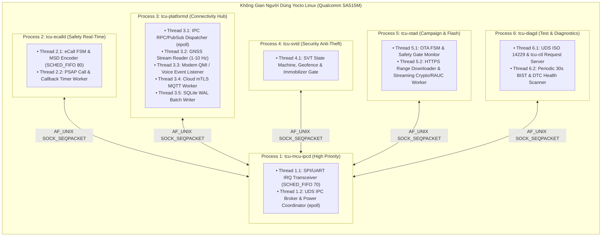

# Tài Liệu Thiết Kế Đa Tiến Trình & Đa Luồng (Multi-Process & Threading Model)
## Dự Án: Hệ Thống Automotive Telematics Control Unit (TCU) Trên Yocto Linux (SA515M + MCU)

Tài liệu này mô tả chi tiết kiến trúc đa tiến trình (Multi-Process Isolation), phân bổ các luồng POSIX bên trong từng Daemon, chính sách lập lịch thời gian thực (`SCHED_FIFO` vs `SCHED_OTHER`), cơ chế giao tiếp `epoll` qua Unix Domain Sockets, giám sát Watchdog hai tầng và trình tự chuyển trạng thái ngủ (Suspend/Shutdown) an toàn với Companion MCU.

---

## 1. Tại Sao Chuyển Từ Single-Process Sang Multi-Process Daemons Cho TCU?

Khác với bài toán xử lý ảnh camera cần truyền khung hình lớn zero-copy trong cùng một tiến trình, hệ thống **Automotive TCU** đặt ưu tiên tối thượng vào **Cô Lập Lỗi An Toàn (Freedom from Interference — ISO 26262)** và **Bảo Mật Phân Quyền**:
* Nếu tiến trình tải gói cập nhật **`tcu-otad`** gặp lỗi giải nén hoặc rò rỉ bộ nhớ, nhân Linux và `systemd` chỉ khởi động lại đúng tiến trình `tcu-otad` — tiến trình khẩn cấp **`tcu-ecalld`** vẫn sống độc lập 100%, sẵn sàng quay số `112` bất kỳ lúc nào.
* Mỗi daemon chạy dưới một tài khoản người dùng Linux riêng biệt (`tcu-ecall`, `tcu-ota`, `tcu-svt`, `tcu-diag`, `tcu-plat`, `tcu-mcu`) với quyền hạn tối thiểu (`Capabilities` & `ProtectSystem=strict`).



---

## 2. Bảng Đặc Tả Chi Tiết Các Tiến Trình & Luồng (14 POSIX Threads Toàn Hệ Thống)

| Tiến Trình | Tên Thread | Chính Sách Lập Lịch | Chu Kỳ / Kích Hoạt | Tải CPU TB | Vai Trò Cốt Lõi |
|---|---|---|---|---|---|
| **`tcu-mcu-ipcd`** | `mcu-spi-trx` | `SCHED_FIFO` (Prio `70`) | Ngắt `MCU_INT_GPIO` / `10 Hz` | `1.5%` | Trao đổi khung SPI/UART CRC-16, bắt tín hiệu va chạm Airbag `< 2 ms` |
| **`tcu-mcu-ipcd`** | `ipc-broker-pwr` | `SCHED_OTHER` (`nice -5`) | `epoll_wait` bất đồng bộ | `1.0%` | Định tuyến gói tin UDS giữa các daemon, quản lý WakeLock & nhịp tim MCU |
| **`tcu-ecalld`** | `ecall-fsm-rt` | **`SCHED_FIFO` (Prio `80`)** | Ngủ chờ sự kiện khẩn cấp | `< 0.1%` (`3%` khi gọi)| Chiếm quyền Modem/Audio, đóng gói MSD 140-byte, điều phối cuộc gọi `112` |
| **`tcu-ecalld`** | `ecall-timer` | `SCHED_FIFO` (Prio `60`) | Timer retry / 60p callback | `< 0.1%` | Quản lý thời gian chờ ACK MSD (20s), quay số lại và chờ PSAP gọi ngược |
| **`tcu-platformd`**| `plat-ipc-loop` | `SCHED_OTHER` (`nice -5`) | `epoll_wait` bất đồng bộ | `1.0%` | Phục vụ các lời gọi RPC từ `ecalld`, `svtd`, `otad`, `diagd` |
| **`tcu-platformd`**| `gnss-reader` | `SCHED_OTHER` | `1 Hz` (Bình thường) / `10 Hz` (Khẩn cấp)| `1.5%` | Đọc tọa độ vệ tinh, cập nhật bộ đệm vòng 3 vị trí (`N`, `N-1`, `N-2`) |
| **`tcu-platformd`**| `modem-monitor` | `SCHED_OTHER` | Bất đồng bộ từ QMI/Modem | `0.5%` | Giám sát sóng 4G/5G, Cell-ID lân cận, trạng thái cuộc gọi VoLTE/CS |
| **`tcu-platformd`**| `mqtt-mtls-wrk` | `SCHED_OTHER` | Sự kiện mạng + Keepalive | `1.5%` | Gửi telemetry mã hóa mTLS 1.3, nhận lệnh từ xa từ Cloud SOC / OTA |
| **`tcu-platformd`**| `sqlite-writer` | `SCHED_OTHER` (`nice +5`) | Mỗi `5 giây` hoặc sự kiện P0/P1 | `< 1.0%` | Ghi gom lô (Batch WAL Transaction) tọa độ SVT ngoại tuyến xuống Flash |
| **`tcu-svtd`** | `svt-main-fsm` | `SCHED_OTHER` (`nice -2`) | Theo sự kiện GNSS / Tamper | `< 0.5%` | Tính khoảng cách Haversine Geofence, theo dõi trộm ngầm, khóa đề an toàn |
| **`tcu-otad`** | `ota-fsm-ctrl` | `SCHED_OTHER` | Sự kiện chiến dịch OTA | `< 0.2%` | Kiểm tra điều kiện an toàn xe đỗ, điều phối tiến trình nâng cấp & rollback |
| **`tcu-otad`** | `ota-io-worker` | `SCHED_IDLE` / `nice +15` | Chỉ chạy khi tải/verify gói | `0%` (`25%` lúc verify)| Tải HTTPS Range từng khối `64 KB`, băm SHA-256, gọi RAUC ghi phân vùng phụ |
| **`tcu-diagd`** | `uds-diag-srv` | `SCHED_OTHER` | Bất đồng bộ theo UDS / CLI | `< 0.5%` | Trả lời gói chẩn đoán UDS ISO 14229 trong hạn mức `P2_Server < 50 ms` |
| **`tcu-diagd`** | `bist-scanner` | `SCHED_OTHER` (`nice +5`) | Mỗi `30 giây` + lúc khởi động | `< 0.3%` | Tự kiểm tra sức khỏe Modem, Ăng-ten GNSS, Audio Loopback, pin BUB, ghi DTC |

---

## 3. Cơ Chế Đồng Bộ, Cách Ly & Chống Nghẽn (Synchronization & Non-Blocking IPC)

### 3.1 Giao tiếp liên tiến trình không nghẽn với `AF_UNIX` `SOCK_SEQPACKET` + `epoll`
* Khác với `SOCK_STREAM` cần tự tách khung byte, `SOCK_SEQPACKET` bảo toàn biên giới từng gói tin nhị phân ngay ở tầng nhân Linux, hỗ trợ kiểm tra danh tính tiến trình gửi thông qua `SO_PEERCRED` (chống giả mạo lệnh giữa các daemon).
* Hàng đợi sự kiện khẩn cấp (`TOPIC_EMERGENCY_TRIGGER`) được gắn cờ ưu tiên cao (`MSG_URGENT`) để `ipc-broker-pwr` đẩy lên đầu hàng đợi phát chuyển tiếp ngay lập tức tới `tcu-ecalld`.

### 3.2 Bảo vệ không làm treo luồng thời gian thực của `tcu-otad`
* Luồng `ota-io-worker` được đặt độ ưu tiên lập lịch thấp nhất (`nice +15` và `IOPRIO_CLASS_IDLE`). Nhờ vậy, ngay cả khi đang giải nén và ghi hàng trăm MB dữ liệu xuống phân vùng `rootfs_b`, I/O của eMMC không bao giờ làm trễ luồng đọc SPI hay luồng quay số khẩn cấp eCall.

---

## 4. Kiến Trúc Giám Sát Watchdog Hai Tầng (Dual-Tier Watchdog Supervision)

Để đảm bảo TCU tự phục hồi khỏi mọi lỗi treo phần mềm hoặc treo nhân Linux (Kernel Panic / Deadlock) suốt vòng đời 10–15 năm trên xe:

```text
[Các Daemon: ecalld, otad, svtd, diagd, platformd, mcu-ipcd]
        │
        │ sd_notify("WATCHDOG=1") mỗi 5 giây (Ngưỡng cắt: WatchdogSec=15s)
        ▼
[Tầng 1: Linux systemd Manager (PID 1)]
        │  -> Nếu 1 daemon bị treo: systemd tự kill & Restart chỉ daemon đó sau 1s
        │
        │ Gửi MSG_HEARTBEAT_WDG qua SPI mỗi 2 giây (chỉ gửi khi IPC Broker khỏe)
        ▼
[Tầng 2: Companion MCU External Supervisor + Hardware Window Watchdog]
        └─► Nếu SA515M mất nhịp tim > 10 giây: MCU kéo chân PMIC_RESET_N để Hard-Reset SA515M!
        └─► Nếu đang Boot OTA Slot B mà Reset lặp 3 lần: Bootloader tự lùi (Rollback) về Slot A!
```

---

## 5. Trình Tự Đưa Hệ Thống Vào Chế Độ Ngủ & Tắt An Toàn (Suspend / Shutdown Sequence)

Khi người lái tắt khóa điện (`KL15 = OFF`), cửa đã khóa và không có phiên eCall / SVT / OTA nào giữ `WakeLock`, hệ thống thực hiện quy trình đóng băng có trật tự để bảo vệ toàn vẹn cơ sở dữ liệu Flash:

1. **Bước 1 (`T = 0 ms`)**: Companion MCU hết thời gian chờ `POST_RUN`, gửi bản tin `MSG_POWER_TRANSITION(PREPARE_SLEEP, grace=3000ms)` lên `tcu-mcu-ipcd`.
2. **Bước 2 (`T = 5 ms`)**: `tcu-mcu-ipcd` phát quảng bá `TOPIC_POWER_TRANSITION(PREPARE_SLEEP)` tới tất cả 5 daemon còn lại.
3. **Bước 3 (`T = 10..400 ms`)**:
   * `tcu-svtd` chốt tọa độ mỏ neo **Geofence** và chuyển sang trạng thái `ARMED`.
   * `tcu-otad` lưu offset tải dở dang vào bảng `ota_journal`.
   * `tcu-platformd` gửi gói `DISCONNECT` sạch sẽ tới Cloud MQTT Broker, sau đó ép ghi toàn bộ bộ đệm SQLite WAL xuống phân vùng `/data` (`sqlite3_wal_checkpoint_v2(..., SQLITE_CHECKPOINT_TRUNCATE)`) và gọi `sync()`.
4. **Bước 4 (`T = 450 ms`)**: Tất cả các daemon gửi phản hồi `SLEEP_READY_ACK` về `tcu-mcu-ipcd`.
5. **Bước 5 (`T = 500 ms`)**: `tcu-mcu-ipcd` gửi `MSG_POWER_TRANSITION(LINUX_READY_FOR_OFF)` xuống MCU và kích hoạt `systemctl suspend` (Suspend-to-RAM) hoặc tắt nguồn miền SA515M theo lệnh PMIC.
6. **Bước 6 (`T > 550 ms`)**: MCU ngắt nguồn phụ tải, chuyển transceiver CAN-FD và cảm biến IMU sang chế độ **Selective Wakeup / Low-Power Stop (`< 0.8 mA`)**, sẵn sàng đánh thức tức thì khi có mở khóa, va chạm hoặc kéo trộm xe.
